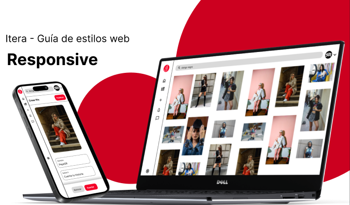

# Itera — Buscador Visual y Red Social 

  
**Itera** es una aplicación web Full-Stack que replica las mecánicas principales y la estética de **Pinterest**. Este proyecto combina un backend robusto construido en **Laravel** con una interfaz interactiva y moderna en **Vue.js** y **Tailwind CSS**, permitiendo a los usuarios descubrir, publicar y organizar colecciones de imágenes en formato mampostería (*masonry*).

---

## Stack Tecnológico
* **Backend:** PHP 8.x / Laravel Framework (Arquitectura MVC)
* **Frontend:** Vue.js, Tailwind CSS, JavaScript, HTML5, CSS3
* **Base de Datos:** MySQL (Relaciones Eloquent ORM)
* **Entorno e Infraestructura:** Docker
* **Diseño UI/UX:** Figma (Prototipado y Guía de Estilos)

---

## Características Principales
* **Diseño tipo Mampostería (*Masonry Grid*):** Renderizado fluido y totalmente responsivo de imágenes adaptado a cualquier dispositivo.
* **Gestión de Contenido (CRUD):** Subida segura de archivos multimedia al servidor, edición y organización de publicaciones.
* **Sistema de Usuarios y Autenticación:** Registro, inicio de sesión y gestión de perfiles personales.
* **Arquitectura Escalable:** Base de datos relacional estructurada mediante migraciones y modelos de Laravel.

---

## 🚀 Instalación y Ejecución Local
ste proyecto está contenerizado con **Docker** para facilitar su despliegue y evitar problemas de dependencias en cualquier sistema operativo. 

Para probarlo en tu equipo:
1. Clona este repositorio en tu máquina local.
2. Configura las variables de entorno necesarias a partir del archivo de ejemplo.
3. Levanta los contenedores de Docker y ejecuta las migraciones de la base de datos.
4. Accede a la aplicación desde tu navegador a través de tu servidor local (`localhost`).